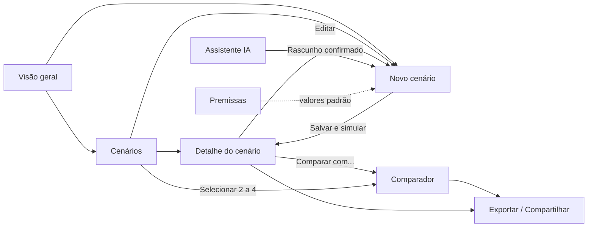

# Especificação do Frontend: Simulador de Decisões

> **Status:** especificação para implementação. O frontend descrito aqui **ainda não existe**. As telas em `src/views/` são um protótipo de MVP e serão substituídas.
> **Público:** quem vai desenvolver o frontend, seja pessoa ou agente.
> **Idioma do produto:** pt-BR.

O Simulador de Decisões é um SaaS de **simulação de cenários para carteiras de crédito pessoal**. Uma pessoa de produto, risco ou finanças descreve o funil e os custos da carteira em um mês, cria variações (por exemplo, desconto na taxa ou alta do CDI) e compara o **resultado ajustado ao risco** de cada uma lado a lado. Cada número vem com a memória de cálculo.

A aparência e a experiência devem lembrar um SaaS B2B moderno (Linear, Stripe Dashboard, Vercel): navegação lateral fixa, área de trabalho limpa, cards de KPI, tabelas densas e legíveis, modo escuro como padrão e feedback imediato.

## Como ler esta pasta

Os arquivos seguem a estrutura da biblioteca de design descrita na Parte 7 de [`METODOLOGIA.md`](../METODOLOGIA.md).

| Arquivo | Conteúdo |
|---|---|
| [`principios.md`](principios.md) | Proposta de valor, personas, tom de voz e regras inegociáveis do produto |
| [`funcionalidades.md`](funcionalidades.md) | Funcionalidades F01–F14 com critérios de aceite e fases |
| [`arquitetura-frontend.md`](arquitetura-frontend.md) | Stack, rotas, estado, persistência, contrato com o motor e estrutura de pastas |
| [`design-system.md`](design-system.md) | Tokens (cores, tipografia, espaçamento), formatação de números, acessibilidade |
| [`telas/`](telas/) | Uma especificação por tela, com wireframe, conteúdo, estados e interações |
| [`componentes/`](componentes/) | Componentes reutilizáveis: quando usar, variações, estados e acessibilidade |

### Telas

| Rota | Tela | Funcionalidades |
|---|---|---|
| `#/` | [Visão geral](telas/01-visao-geral.md) | Resumo da carteira e atalhos |
| `#/cenarios` | [Cenários](telas/02-cenarios.md) | Biblioteca de cenários salvos |
| `#/cenarios/novo` · `#/cenarios/:id/editar` | [Editor de cenário](telas/03-editor-cenario.md) | F01, F10, F11, F13 |
| `#/cenarios/:id` | [Detalhe do cenário](telas/04-detalhe-cenario.md) | F04, F05, F06, F12 |
| `#/comparar` | [Comparador](telas/05-comparador.md) | F02, F03, F06, F07, F12 |
| `#/assistente` | [Assistente IA](telas/06-assistente-ia.md) | F08, F09 (fase 2) |
| `#/premissas` | [Premissas](telas/07-premissas.md) | F10, F13 |
| `#/compartilhado/...` | [Compartilhar e exportar](telas/08-compartilhar-exportar.md) | F14 |

### Componentes

[App shell](componentes/app-shell.md) · [Botão](componentes/botao.md) · [Campo de formulário](componentes/campo-formulario.md) · [Card de KPI](componentes/card-kpi.md) · [Tabela de comparação](componentes/tabela-comparacao.md) · [Gráfico waterfall](componentes/grafico-waterfall.md) · [Memória de cálculo](componentes/memoria-calculo.md) · [Alertas e banners](componentes/alertas.md) · [Estados vazios, carregamento e erro](componentes/estados.md)

## Mapa de navegação

## Fora do escopo desta especificação

- Backend, API, banco de dados e autenticação. A decisão sobre login público ou obrigatório está em aberto (veja [`docs/EXECUCAO.md`](../docs/EXECUCAO.md)), e a especificação funciona 100% offline.
- Fórmulas. O frontend **não calcula**: consome `simulate()` de `src/lib/engine.js`. As fórmulas atuais são provisórias.
- Pitch e roteiro de demonstração (fase 4).
